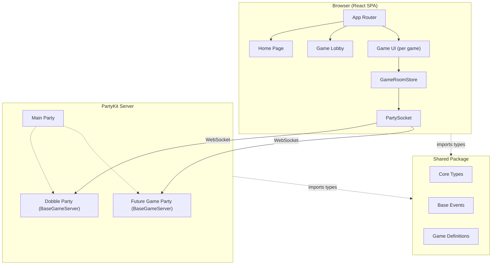

# Architecture

A real-time multiplayer game platform where users play against each other in the browser. The system is designed so that adding a new game is formulaic -- each game plugs into a shared framework that handles player management, room lifecycle, scoring, and real-time synchronization.

## Tech Stack

| Layer | Technology |
|-------|-----------|
| Frontend | React (Vite + TypeScript), scaffolded via `npm create vite@latest -- --template react-ts` |
| State Management | Preact Signals (`@preact/signals-react`) |
| Routing | `react-router-dom` |
| Real-time | PartyKit (WebSocket server) via `partysocket` client |
| Monorepo | npm workspaces |
| Deployment | App: Vercel, Server: PartyKit (`npx partykit deploy`) |

## Package Structure

```
dobble-game/
  package.json               # Root workspace config
  vercel.json                # Vercel deployment (builds app)
  docs/
    ARCHITECTURE.md          # This file

  packages/
    shared/                  # Shared types and game contracts
      src/
        index.ts             # Barrel exports
        types.ts             # Player, GamePhase, BaseRoomState
        events.ts            # BaseClientEvent, BaseBroadcastEvent
        game-definition.ts   # GameDefinition interface
        games/
          dobble/
            types.ts         # DobbleGameState, DobbleClientEvent, etc.

    server/                  # PartyKit backend
      src/
        base-game-server.ts  # Abstract base class all game servers extend
        games/
          dobble/
            server.ts        # DobbleServer extends BaseGameServer
            logic.ts         # Deck generation, matching algorithm
      partykit.json          # Multi-party config (one entry per game)

    app/                     # React SPA
      src/
        App.tsx              # Root component with router
        hooks/
          useGameRoom.ts     # Generic hook wrapping GameRoomStore
        games/
          registry.ts        # Maps game IDs to components + definitions
          dobble/
            DobbleGame.tsx   # Dobble game UI
        pages/
          Home.tsx           # Game selection
          Lobby.tsx          # Pre-game player waiting room
      vite.config.ts
```

## Architecture Diagram



## Core Game Model

Every multiplayer game shares these concepts, defined in `packages/shared`:

### Player Lifecycle

A player is identified by two IDs:
- **`id`** -- PartyKit connection ID. Changes on every WebSocket reconnect.
- **`clientId`** -- Persistent UUID stored in `sessionStorage`. Stable across page refreshes and reconnects within a session. Used for scoring and identity.

### Game Phases

All games follow the same lifecycle: `lobby` -> `playing` -> `finished` -> (reset) -> `lobby`.

- **`lobby`**: Players join the room and wait. The host can start the game once minimum player count is met.
- **`playing`**: Game is active. Game-specific events flow between client and server.
- **`finished`**: Game is over. Final scores are displayed. The room can be reset to return to lobby.

### Base Events

The framework handles these events automatically for all games:

**Client -> Server (BaseClientEvent):**
- `player:join` -- Sent on WebSocket open. Includes `name` and `clientId`.
- `player:leave` -- Sent on disconnect.
- `game:start` -- Host triggers the game to begin.
- `game:reset` -- Reset the room back to lobby phase.

**Server -> Client (BaseBroadcastEvent):**
- `room:sync` -- Full room state snapshot, sent to newly connecting clients.
- `player:joined` / `player:left` -- Updated player list.
- `scores:updated` -- Updated score map.
- `phase:changed` -- Game phase transition.

Game-specific events are defined per-game and discriminated via the `type` field. The full event union for a game is `BaseClientEvent | GameClientEvent` and `BaseBroadcastEvent | GameBroadcastEvent`.

### Game Definition

Each game declares a `GameDefinition` object with metadata:

```typescript
interface GameDefinition {
  id: string;           // Must match the party name in partykit.json
  name: string;         // Display name
  description: string;
  minPlayers: number;
  maxPlayers: number;
}
```

## Server Architecture (PartyKit)

### Multi-Party Configuration

Each game type is a separate PartyKit "party", configured in `partykit.json`:

```json
{
  "name": "game-server",
  "main": "src/main.ts",
  "parties": {
    "dobble": "src/games/dobble/server.ts"
  }
}
```

Each party is isolated -- it has its own server class, its own rooms, and its own state. Clients connect to a specific party by name:

```typescript
new PartySocket({
  host: PARTYKIT_HOST,
  room: roomId,
  party: "dobble"
});
```

### BaseGameServer

All game servers extend `BaseGameServer<TGameState, TClientEvent, TBroadcastEvent>`, an abstract class that handles:

- Player join/leave/reconnect with broadcast
- Game phase transitions (lobby -> playing -> finished)
- Score tracking and broadcasting
- Full state sync on new connections
- Message routing (base events handled automatically, game events delegated)

Each game implements three abstract methods:

| Method | Purpose |
|--------|---------|
| `createInitialState()` | Returns the initial game-specific state |
| `handleGameEvent(event, sender)` | Processes a game-specific client event |
| `getGameStateForClient()` | Returns broadcast events to sync game state to a new client |

Protected helpers available to game implementations:

| Helper | Purpose |
|--------|---------|
| `broadcastToAll(event)` | Send to all connected clients |
| `broadcastToOthers(event, excludeId)` | Send to all except one |
| `updateScore(clientId, delta)` | Increment a player's score and broadcast |
| `endGame()` | Transition to finished phase |
| `resetGame()` | Reset to lobby, call `createInitialState()` |

## Frontend Architecture (React + Preact Signals)

### State Management

All state management uses **Preact Signals** (`@preact/signals-react`). No `useState` or `useReducer` for game state.

Key APIs:
- `signal(value)` -- Reactive container, access via `.value`
- `computed(() => ...)` -- Derived values that auto-update
- `effect(() => ...)` -- Side effects triggered by signal changes
- `batch(() => ...)` -- Group multiple signal updates into one render
- `useSignal(value)` -- Component-local signal (hook form)

### GameRoomStore

A generic class that manages the PartySocket connection and exposes room state as signals:

```typescript
class GameRoomStore<TBroadcastEvent extends { type: string }> {
  // Signals -- read .value in JSX for fine-grained reactivity
  players = signal<Player[]>([]);
  phase = signal<GamePhase>('lobby');
  scores = signal<Record<string, number>>({});
  connectionStatus = signal<'connecting' | 'connected' | 'disconnected'>('connecting');

  constructor(gameType: string, roomId: string, playerName: string) {
    // Creates PartySocket with party: gameType
    // Handles base events automatically
    // Delegates game-specific events to registered handlers
  }

  sendEvent(event: object): void;
  startGame(): void;
  onGameEvent(handler: (event: TBroadcastEvent) => void): void;
  dispose(): void;
}
```

The `useGameRoom` hook wraps this for React lifecycle:

```typescript
function useGameRoom<TBroadcastEvent extends { type: string }>(
  gameType: string,
  roomId: string,
  playerName: string
): GameRoomStore<TBroadcastEvent>;
```

### Game Registry

Games are registered in `packages/app/src/games/registry.ts`:

```typescript
import { DobbleGame } from './dobble/DobbleGame';
import { dobbleDefinition } from 'shared/games/dobble/types';

export const gameRegistry = {
  dobble: { component: DobbleGame, definition: dobbleDefinition },
} as const;
```

The registry drives the home page game list and dynamic routing.

## Development Commands

```bash
# Install all workspace dependencies
npm install

# Run the React app dev server
npm run app:dev

# Run the PartyKit dev server
npm run server:dev

# Build the React app
npm run app:build

# Build the PartyKit server
npm run server:build

# Deploy the PartyKit server
npm run server:deploy    # runs: npx partykit deploy
```

## Adding a New Game

Adding a new game (e.g. "trivia") requires exactly **4 touches**:

### 1. Define types -- `packages/shared/src/games/trivia/types.ts`

```typescript
import type { GameDefinition } from '../../game-definition.js';

export interface TriviaGameState {
  currentQuestion: Question | null;
  questionIndex: number;
  totalQuestions: number;
}

export type TriviaClientEvent =
  | { type: 'trivia:answer'; questionId: string; answer: string };

export type TriviaBroadcastEvent =
  | { type: 'trivia:question'; question: Question; index: number; total: number }
  | { type: 'trivia:result'; correct: boolean; correctAnswer: string };

export const triviaDefinition: GameDefinition = {
  id: 'trivia',
  name: 'Trivia',
  description: 'Answer questions faster than your opponents!',
  minPlayers: 2,
  maxPlayers: 10,
};
```

### 2. Create server -- `packages/server/src/games/trivia/server.ts`

```typescript
import { BaseGameServer } from '../../base-game-server.js';
import type { TriviaGameState, TriviaClientEvent, TriviaBroadcastEvent } from 'shared/games/trivia/types';

export default class TriviaServer extends BaseGameServer<
  TriviaGameState,
  TriviaClientEvent,
  TriviaBroadcastEvent
> {
  createInitialState(): TriviaGameState {
    return { currentQuestion: null, questionIndex: 0, totalQuestions: 10 };
  }

  handleGameEvent(event: TriviaClientEvent, sender: Party.Connection): void {
    if (event.type === 'trivia:answer') {
      // validate answer, update score, broadcast result, advance question
    }
  }

  getGameStateForClient(): TriviaBroadcastEvent[] {
    // return current question state for late-joining clients
  }
}
```

Then add to `partykit.json`:

```json
{
  "parties": {
    "dobble": "src/games/dobble/server.ts",
    "trivia": "src/games/trivia/server.ts"
  }
}
```

### 3. Create UI -- `packages/app/src/games/trivia/TriviaGame.tsx`

```typescript
import { useGameRoom } from '../../hooks/useGameRoom';
import { useSignal } from '@preact/signals-react';
import type { TriviaBroadcastEvent } from 'shared/games/trivia/types';

export function TriviaGame({ roomId, playerName }: Props) {
  const room = useGameRoom<TriviaBroadcastEvent>('trivia', roomId, playerName);
  const question = useSignal<Question | null>(null);

  room.onGameEvent((event) => {
    if (event.type === 'trivia:question') question.value = event.question;
  });

  return (
    <div>
      <p>Players: {room.players.value.length}</p>
      {/* render question, answer buttons, scoreboard */}
    </div>
  );
}
```

### 4. Register -- `packages/app/src/games/registry.ts`

```typescript
import { TriviaGame } from './trivia/TriviaGame';
import { triviaDefinition } from 'shared/games/trivia/types';

export const gameRegistry = {
  dobble: { component: DobbleGame, definition: dobbleDefinition },
  trivia: { component: TriviaGame, definition: triviaDefinition },
} as const;
```

This auto-adds the game to the home page list and routing.
